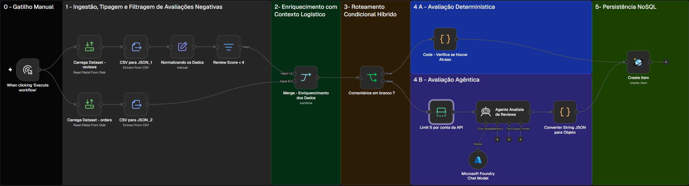

# Agente Analista de Reviews da Olist

Workflow automatizado desenvolvido no **N8N** para analisar avaliações negativas de clientes da Olist e registrar um diagnóstico estruturado no **Azure Cosmos DB**.

O processamento combina regras determinísticas em **JavaScript** com análise semântica realizada por um modelo **GPT** hospedado no **Microsoft Foundry/Azure OpenAI**.

## Tecnologias

- **N8N**: orquestração do fluxo e integração dos nós.
- **JavaScript**: validação de atraso e conversão da resposta da IA.
- **Microsoft Foundry / Azure OpenAI**: modelo `gpt-5-mini` para interpretação agêntica das avaliações.
- **Azure Cosmos DB**: armazenamento NoSQL dos diagnósticos consolidados.
- **CSV**: fonte de dados de avaliações e pedidos.

## Visão geral do workflow



O fluxo é acionado manualmente e processa avaliações com nota inferior a 4. Com base no texto do comentário e nos dados operacionais do pedido, ele identifica uma possível causa, define severidade e destino e salva o resultado no contêiner `reviews`.

## Etapas do fluxo

### Etapa 1 - Ingestão, tipagem e filtragem

Os datasets de avaliações e pedidos são carregados em paralelo pelos nós `Carrega Dataset - reviews` e `Carrega Dataset - orders`. Os arquivos passam por `CSV para JSON_1` e `CSV para JSON_2`, o campo `review_score` é convertido em número em `Normalizando os Dados` e o nó `Review Score < 4` mantém apenas avaliações negativas.

### Etapa 2 - Enriquecimento com contexto logístico

O nó `Merge - Enriquencimento dos Dados` relaciona avaliações e pedidos pela chave `order_id`, adicionando status, prazo estimado e data efetiva de entrega.

### Etapa 3 - Roteamento condicional híbrido

O nó `Comentários em branco ?` verifica se título e mensagem estão vazios:

- **Sem comentário**: segue para a avaliação determinística.
- **Com comentário**: segue para a avaliação agêntica.

### Etapa 4A - Avaliação determinística

O nó `Code - Verifica se Houve Atraso` compara as datas em JavaScript. Pedidos entregues depois do prazo ou ainda não entregues na data da resposta à avaliação são classificados como `Atraso`, com destino `Logística` e severidade `Alta`. Na implementação atual, avaliações sem atraso recebem categoria `Outro`, destino `Revisão humana` e severidade `Baixa`.

### Etapa 4B - Avaliação agêntica

O fluxo limita o processamento a 5 itens por execução no nó `Limit 5 por conta da API`. O `Agente Analista de Reviews` recebe texto e dados do pedido, usa o `Microsoft Foundry Chat Model` e devolve JSON com categoria, origem, divergência, destino, severidade, confiança, resumo e identificadores.

O nó `Converter String JSON para Objeto` transforma a resposta textual em objeto estruturado e valida o conteúdo. Um resultado com confiança abaixo de 0,8 pode ser direcionado para revisão humana.

### Etapa 5 - Persistência NoSQL

O nó `Create item` grava os resultados de ambas as vias no Azure Cosmos DB, no contêiner `reviews`. A chave composta `order_id + "_" + review_id` é usada como `id`.

## Estrutura persistida

```json
{
  "id": "order_id_review_id",
  "order_id": "ID do pedido",
  "review_id": "ID da avaliação",
  "categoria": "Categoria identificada",
  "origem": "Texto ou dados operacionais",
  "divergencia": "Indicação de conflito entre texto e fatos",
  "destino": "Logística, Seller, Qualidade ou Revisão humana",
  "severidade": "Alta, Média ou Baixa",
  "confianca": 0.95,
  "resumo": "Resumo da causa em uma frase"
}
```

## Como usar

1. Importe o arquivo [`n8n/workflow_analista_reviews.json`](n8n/workflow_analista_reviews.json) no N8N.
2. Configure as credenciais do Microsoft Foundry/Azure OpenAI e do Azure Cosmos DB.
3. Disponibilize os datasets CSV no diretório configurado pelo workflow.
4. Execute o workflow pelo gatilho manual.
5. Consulte os documentos gravados no contêiner `reviews` do Cosmos DB.
